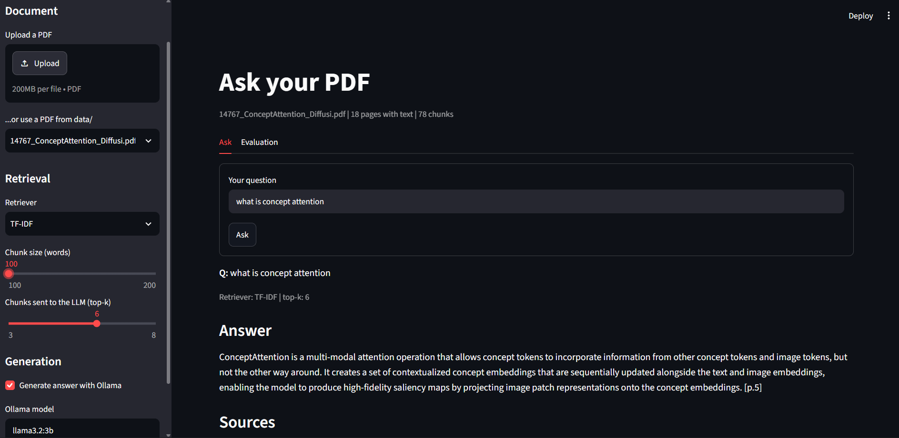

# PDF Question Answering with RAG

A small retrieval-augmented generation (RAG) system that answers questions about a PDF using only the document's content, with page citations. It is built on core NLP techniques (text cleaning, chunking, TF-IDF, sentence embeddings, rank fusion) and a local LLM, so it runs for free on a laptop.



## Features
- PDF text extraction with cleanup (running headers, hyphenation, extraction quirks)
- Overlapping word-based chunking that keeps page numbers
- Three interchangeable retrievers: TF-IDF (scikit-learn), dense embeddings (sentence-transformers + FAISS) and hybrid (reciprocal rank fusion)
- Grounded answer generation with a local LLM via Ollama
- Citation check that warns when an answer cites pages that were not retrieved
- Evaluation script (Hit@k, MRR) over a hand-labeled question set
- Streamlit dashboard and a command-line app

## How it works
```
PDF -> extract + clean text -> chunk (keeps page numbers)
    -> retriever (TF-IDF | dense | hybrid) -> top-k chunks
    -> prompt + local LLM (Ollama) -> answer + sources + citation check
```

## Quickstart
```bash
git clone <your-repo-url>
cd <your-repo>
python -m venv .venv
.venv\Scripts\activate          # macOS/Linux: source .venv/bin/activate
pip install -r requirements.txt
ollama pull llama3.2:3b         # requires Ollama (https://ollama.com)
```
Put a text-based PDF in `data/` (the sample used here: <link to the paper>).

```bash
streamlit run streamlit_app.py                       # dashboard
python app.py data/<your>.pdf                        # command line
python -m src.evaluate data/<your>.pdf               # retrieval evaluation
```

## Evaluation
30 hand-labeled questions on one paper (about half phrased differently from the paper's wording). A retrieval counts as a hit if a retrieved chunk is on a gold page.

| Chunk size | Retriever | Hit@1 | Hit@3 | Hit@5 | MRR |
|---|---|---|---|---|---|
| 100 | TF-IDF | 0.67 | 0.90 | 0.97 | **0.78** |
| 100 | Dense | 0.57 | 0.73 | 0.80 | 0.66 |
| 100 | Hybrid | 0.67 | 0.83 | 0.87 | 0.74 |
| 150 | TF-IDF | 0.60 | 0.93 | 0.97 | 0.76 |
| 150 | Dense | 0.60 | 0.70 | 0.83 | 0.67 |
| 150 | Hybrid | 0.53 | 0.80 | 0.90 | 0.67 |
| 200 | TF-IDF | 0.63 | 0.77 | 0.97 | 0.74 |
| 200 | Dense | 0.50 | 0.73 | 0.83 | 0.61 |
| 200 | Hybrid | 0.67 | 0.87 | 0.90 | 0.76 |

**Findings**
- TF-IDF was the best or tied-best retriever at every chunk size on this term-heavy scientific paper. A small embedding model (all-MiniLM-L6-v2) and a simple rank fusion did not beat it.
- Smaller chunks helped dense retrieval; its quality drops at 200 words, consistent with the model's 256-token input limit.
- Early on, figure labels, running headers and the bibliography polluted the results; cleaning the text and filtering those chunks mattered more than tuning the retriever.

## Limitations
- Evaluated on a single document with 30 questions and page-level matching, so small differences between retrievers are within noise.
- Text-based PDFs only (no OCR); tables and multi-column layouts can extract poorly. Figure-only pages and reference lists are filtered out by heuristics.
- The text cleaning includes a rule specific to the sample paper's small-caps title.
- A small local LLM can misread context, and its inline page citations are not always reliable. The citation check flags pages outside the retrieved context but cannot detect wrong claims.

## Future work
- Agentic RAG: query rewriting, multi-step retrieval and answer self-checking, with `retrieve()` exposed as a tool
- Stronger embedding model and a reranker
- Multi-document support and chunk-level evaluation

## Project structure
```
src/ingest.py     PDF extraction, cleaning, chunking
src/embed.py      embeddings and FAISS index
src/retrieve.py   TF-IDF, dense and hybrid retrievers
src/generate.py   prompt, LLM call, citation check
src/evaluate.py   Hit@k and MRR evaluation
app.py            command-line app
streamlit_app.py  dashboard
data/eval_questions.json   labeled evaluation questions
results.csv       latest evaluation results
```